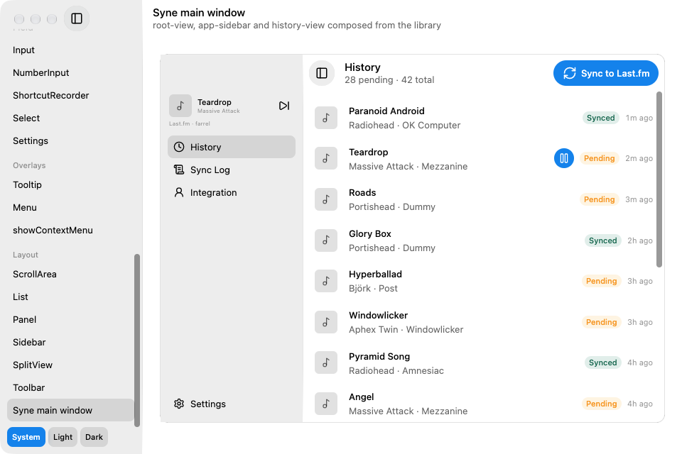
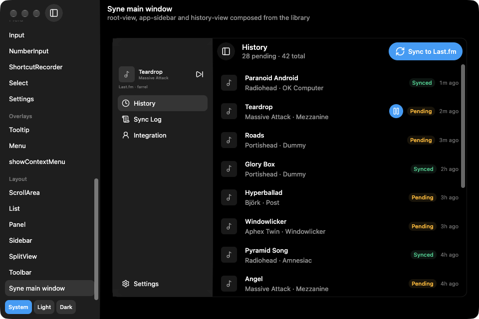
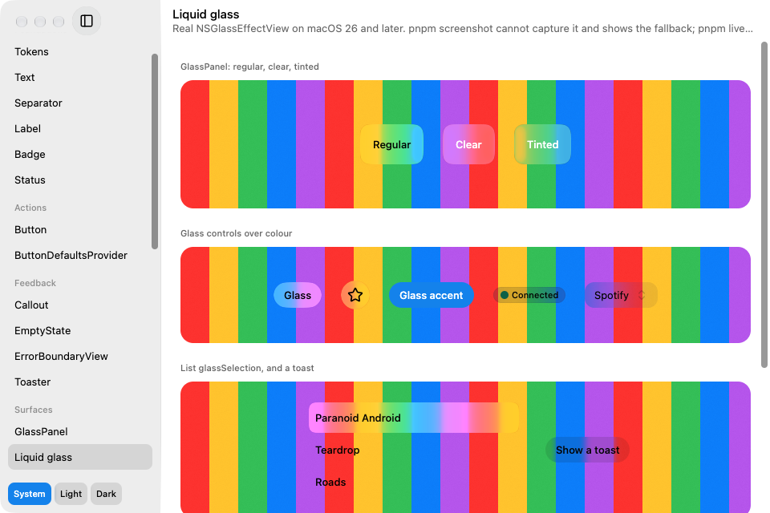

# ghia-swiftui

SwiftUI-look [Solid](https://www.solidjs.com) components for macOS apps on [ghia](https://github.com/fdarian/ghia) (`@ghia/solid`, Vite and Bun, no webview). The component names, props and variants are those of [syne](https://github.com/fdarian/syne)'s `@syne/ui`, so a syne screen moves over by changing imports and React idioms to Solid ones. Surfaces such as the sidebar, panels, popups and glass buttons are real liquid glass (`NSGlassEffectView`).

To try the components first, run `npx ghia-swiftui` on an Apple Silicon Mac. It opens the component gallery, downloading a signed binary from the GitHub Release on the first run.

| Light                                                                                | Dark                                                |
| ------------------------------------------------------------------------------------ | --------------------------------------------------- |
|  |  |

## Install

macOS, [Bun](https://bun.sh) and [pnpm](https://pnpm.io) 12. Install `ghia-swiftui` from npm together with its peers.

```jsonc
// package.json
"dependencies": {
	"@ghia/native": "0.12.1",
	"@ghia/solid": "0.12.1",
	"ghia": "0.12.1",
	"ghia-swiftui": "0.1.0",
	"solid-js": "1.9.15"
},
"devDependencies": {
	"vite": "8.3.7"
}
```

pnpm may also ask you to exempt the `@ghia/*` versions and `ghia-base-ui` from `minimumReleaseAge`; it adds the `minimumReleaseAgeExclude` entries itself.

ghia runs on Vite. `ghia()` sets up the environment the app runs in and `solid()` compiles your JSX for ghia.

```ts
// vite.config.mts
import { solid } from '@ghia/solid/vite';
import { ghia } from 'ghia';
import { defineConfig } from 'vite';

export default defineConfig({
	plugins: [ghia(), solid()],
});
```

For TypeScript, set `"jsx": "preserve"` and `"jsxImportSource": "@ghia/solid"`, and leave the DOM lib out (`@total-typescript/tsconfig/bundler/no-dom/app` does): with it, the library's source reports errors.

<details>
<summary>Installing from a local checkout</summary>

Point the dependency at the package folder, `"ghia-swiftui": "file:../ghia-swiftui/packages/swiftui"`.

</details>

## Use it

An app renders inside four things, once, at its root:

- `setPanelStorage(...)` before the first render, if any `SplitView` or `PanelGroup` has a `storageKey`. There is no default location; `createFilePanelStorage({ appName })` keeps layouts under `~/Library/Application Support/<appName>/`.
- `ColorSchemeProvider` around everything. It binds the tokens to the window's appearance; a token read outside it throws.
- `ContextMenuHost`, where `showContextMenu` draws its menu.
- `Toaster`, where `toast.*` draws.

`TooltipProvider` goes around anything that holds a `Tooltip`.

```tsx
import { render } from '@ghia/solid';
import {
	Button,
	ColorSchemeProvider,
	ContextMenuHost,
	createFilePanelStorage,
	setPanelStorage,
	Text,
	Toaster,
	TooltipProvider,
	toast,
} from 'ghia-swiftui';
import { semanticColors } from 'ghia-swiftui/tokens/semantic-colors';

setPanelStorage(createFilePanelStorage({ appName: 'my-app' }));

render(
	() => (
		<ColorSchemeProvider>
			<TooltipProvider>
				<div
					style={{
						position: 'fixed',
						top: 0,
						right: 0,
						bottom: 0,
						left: 0,
						backgroundColor: semanticColors.backgroundSolid,
						display: 'flex',
						flexDirection: 'column',
						alignItems: 'flex-start',
						gap: 12,
						padding: 24,
					}}
				>
					<Text variant="heading1">Hello</Text>
					<Button variant="accent" onClick={() => toast.success('Saved')}>
						Save
					</Button>
				</div>
				<ContextMenuHost />
				<Toaster />
			</TooltipProvider>
		</ColorSchemeProvider>
	),
	{
		title: 'my-app',
		width: 480,
		height: 320,
		titlebarTransparent: true,
	},
);
```

`ghia dev src/main.tsx` opens it, and `ghia build src/main.tsx` compiles it into one executable. The window is opaque (ghia's default) and ghia paints it black, so the root paints the window colour, as the `div` above does with `backgroundSolid`: a `Sidebar`'s glass samples whatever is painted behind it, and over an unpainted window it reads as a dark grey pane, not the pale frosted sidebar of macOS. An app shell is a `SplitView` with a `Sidebar` in its `sidebar` slot: [`apps/demo/src/app.tsx`](apps/demo/src/app.tsx) is one.

Tokens are plain objects of getters over the colour scheme, imported from their own modules (`import { semanticColors } from 'ghia-swiftui/tokens/semantic-colors'`). The accent is `#138af2` until the app calls `setAccentColor('#rrggbb')`, since ghia cannot read the system accent. `applyColorScheme(true | false)` forces a scheme and `followSystemColorScheme()` returns to the OS.

## Components

| Section     | Components                                                                                                                                                                                                                                                |
| ----------- | --------------------------------------------------------------------------------------------------------------------------------------------------------------------------------------------------------------------------------------------------------- |
| Foundations | `Text`, `Separator`, `Label`, `Badge`, `Status`, `Icon`, tokens                                                                                                                                                                                           |
| Actions     | `Button`, `ButtonDefaultsProvider`                                                                                                                                                                                                                        |
| Feedback    | `Callout`, `EmptyState` (`Media`, `Title`, `Description`, `Actions`), `ErrorBoundaryView`, `toast`, `Toaster`                                                                                                                                             |
| Surfaces    | `GlassPanel`                                                                                                                                                                                                                                              |
| Forms       | `Checkbox`, `RadioGroup`, `RadioGroupItem`, `Field` (`FieldSet`, `FieldGroup`, `FieldLabel`, `FieldDescription`, `FieldError`, ...), `Input`, `NumberInput`, `ShortcutRecorder`, `Select` (`SelectTrigger`, `SelectValue`, `SelectContent`, `SelectItem`) |
| Overlays    | `Tooltip`, `TooltipProvider`, `Menu`, `showContextMenu`, `ContextMenuHost`                                                                                                                                                                                |
| Layout      | `ScrollArea`, `List`, `Panel`, `PanelGroup`, `Sidebar` (`SidebarList`, `SidebarListItem`, `SidebarFooter`), `SplitView`, `Toolbar` (`ToolbarRow`, `ToolbarContent`, `ToolbarTitle`, `ToolbarDescription`, `ToolbarActions`)                               |

What syne has and this does not, and the reverse, is in [`packages/swiftui/DRIFT.md`](packages/swiftui/DRIFT.md): one row per component, with the cause. `Select` and `showContextMenu` are in-window popups, not `NSMenu`; there is no StyleX, `render` prop or `data-slot`.

## Liquid glass

`GlassPanel`, `Sidebar`, `Menu`, the `Select` popup, `Toast`, glass `Button`s and the selected row of a `List` with `glassSelection` are real `NSGlassEffectView`s on macOS 26 and later. They sample what is painted beneath them in the window, GPU content included, and follow the window appearance. No native addon or build step makes them: the view is created from JS with `bun:ffi` on the Objective-C runtime, inside ghia's `<nativeview>`.



Elsewhere a surface wears an in-window material, a neutral tint over a 24px backdrop blur, so none renders empty. That is what shows on macOS before 26, and in a window that is not on screen (so `pnpm screenshot` shows it).

<details>
<summary>What real glass costs you</summary>

- A `backdropFilter` painted over a native view blurs nothing, so a `Sidebar` fades its list out under its toolbar and footer instead of blurring it.
- Each glass is a native view and a layer. Prefer a few large surfaces over many small ones.
- `captureScreenshot` is the Metal frame and holds no AppKit view. `pnpm live-capture` captures the composited window.

</details>

## Running the demo

The demo in `apps/demo` shows every component, in light and dark, in a native window. Clone, `pnpm install`, then from the root:

```bash
pnpm start                      # the demo window
pnpm screenshot <demo>          # offscreen captures to apps/demo/screenshots/<demo>/, light and dark
GPUIX_BACKGROUND=1 pnpm live-capture <demo> [step...]   # a real window, glass included
pnpm glass-check                # real glass present, by window pixels and the view tree
pnpm window-check               # layout against the traffic lights, resize, collapse, glass
```

`live-capture`, `glass-check` and `window-check` open windows parked, with a thin strip on a display you are not working on, and read their own pixels; they post no input and touch no other app. A window another app covers is given no frames, so they report "not checkable". `live-capture` also takes steps (`shot=`, `click=`, `wheel=`, `dark`, `light`, `move=`; see its header).

`pnpm check` at the root runs the type and lint checks.

## License

[MIT](LICENSE)
